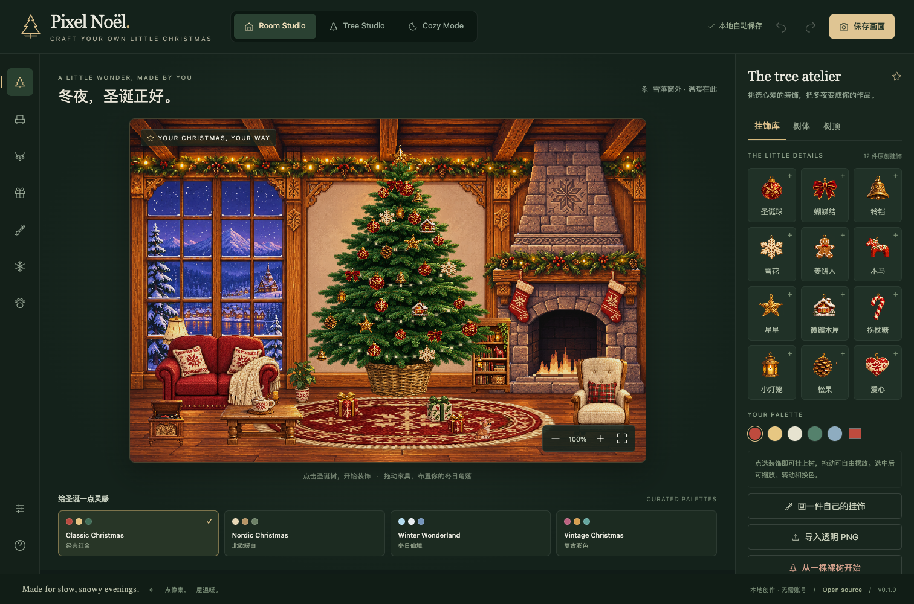

<div align="center">

# Pixel Noël

**Craft your own little Christmas.**

[**Enter the cabin · Live Demo**](https://wilsonwuww.github.io/pixel-noel/) · [简体中文](README.zh-CN.md)

A small, warm Christmas world you can make your own. A browser-only pixel art studio with a beautifully layered cabin, independently editable ornaments, freehand lights and a tiny pixel workshop.



</div>

## Make yourself at home

- **Room Studio** — arrange 24 furniture and decorative objects, gifts, rugs, cushions and lanterns. Floor, wall, tabletop and ceiling props have their own placement ranges.
- **Tree Studio** — place 12 independently editable ornaments anywhere in the canopy. Move, scale, rotate, recolor, duplicate and delete. Clear the tree and start from bare branches.
- **Draw with light** — sketch independent light strands and ribbons. Adjust spacing, color, brightness and steady, breathing or alternating animation.
- **Pixel workshop** — pencil, eraser, flood fill, eyedropper, a custom palette, undo/redo and transparent PNG import/export. Reuse your art from a persistent personal library.
- **Four palettes** — Classic, Nordic, Winter Wonderland and Vintage preserve your existing layout.
- **Cozy Mode** — hide the studio and enjoy snow, fireplace, fireworks, a small cat or dog and optional original synthesized music.
- **Your work stays yours** — local IndexedDB saves, scene-wide undo/redo, JSON backups and clean PNG scene capture. No account, paid API or runtime model.

## Run locally

Node.js **22.12+** (or 24+) is recommended.

```sh
npm ci
npm run dev
```

Open the printed localhost URL. Visitors to the live demo need only a modern browser.

```sh
npm run build        # TypeScript validation + production build
npm run preview      # preview production output
npx playwright install chromium
CI=1 npm test        # desktop + mobile-emulation browser tests
```

Local tests use installed Google Chrome unless `CI=1`. The included Actions workflow installs Chromium and runs the same functional checks before Pages deployment.

## How it works

Vite + TypeScript + one Canvas 2D scene. Static architectural art is separate from tree, decoration, furniture and pet sprites. The tree is cached offscreen; sprites are reused from lossless WebP atlases; extra furniture loads on demand. Animation pauses in hidden tabs. DOM controls remain outside the render surface. There are **zero production npm dependencies**.

Source: `model.ts` (scene, validation, history, storage), `art.ts` (composition and animation), `assets.ts` (manifest), `workshop.ts` (pixel editor), `main.ts` (studio interaction). All three modes edit one scene.

## Contribute an ornament or a cozy corner

See [ASSET_SPEC.md](ASSET_SPEC.md), [CONTRIBUTING.md](CONTRIBUTING.md), [DESIGN.md](DESIGN.md) and the four focused art/UI guides under [.agents/skills](.agents/skills). Furniture definitions in `public/assets/manifest.json` can be extended without editing the renderer. Custom PNGs can also be imported directly in the studio.

## Honest release notes

This is an early **v0.1.0** creative studio, with documented limitations:

- Two independent tree masters (Nordmann fir and blue spruce); width, height, snow, color, richness and basket styles are adjustable. Botanical branch-density variation is a color-richness control rather than regenerated geometry.
- Ornament colors use a translucent tint; furniture colors use hue adjustment, rather than fully segmented material masks.
- Canopy path masking uses an approximate branch envelope. Per-needle back/front strand occlusion is future work.
- Pets have four sprite poses; the optional personal character currently exposes hair and sweater colors. Hairstyles, clothing/accessory modules and photo mapping are deferred.
- Desktop Chrome and mobile **viewport/touch emulation** are tested; no physical mobile-device or Safari/Firefox certification is claimed.
- High-detail lossless art exceeds the 3 MB aspirational initial-load budget. Exact measured bytes, frame samples and test limits are in [docs/QA.md](docs/QA.md) and [docs/performance.json](docs/performance.json).

## Licenses and credits

Code: [MIT](LICENSE). Project-created, AI-assisted raster art: [CC BY 4.0](public/assets/LICENSE.md), to the extent rights apply. UI icons and synthesized audio are original code. User reference images were used as visual direction and are **not** redistributed. No downloaded third-party artwork or music is bundled. Research sources and their separately checked licenses: [docs/RESEARCH.md](docs/RESEARCH.md).
