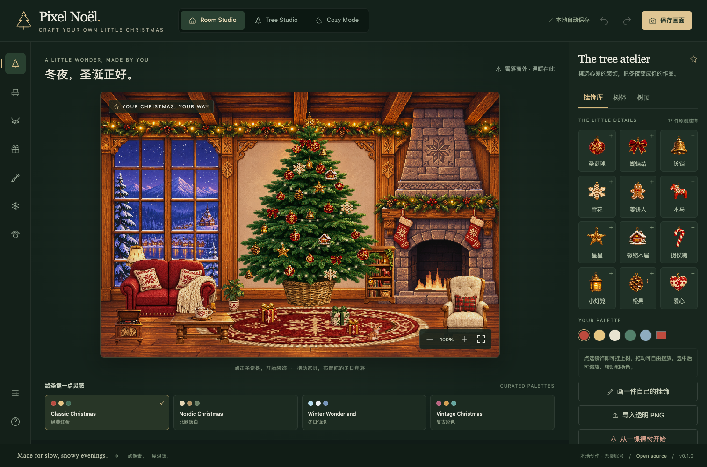

# Pixel Noël · 像素圣诞小屋

**Craft your own little Christmas. 给自己，造一个小小的圣诞。**

[**点击进入在线小屋**](https://wilsonwuww.github.io/pixel-noel/) · [English](README.md)



一个在浏览器中运行的北欧像素圣诞创作空间。无需账号、安装、API Key 或服务器推理。

## 可以做什么

- 在同一间正面视角木屋中，独立摆放 24 件家具与装饰。
- 为圣诞树添加 12 种精细挂饰，自由移动、缩放、旋转、换色、复制和删除。
- 一键清空树饰，从裸树重新创作；调整树高、宽度、松针色调、积雪、浓郁度、树盆与树顶。
- 在树冠上画出多段独立灯带与丝带，调整灯珠间距、亮度、颜色与呼吸、交替闪烁模式。
- 用 32 × 32 透明像素画板制作原创素材；支持铅笔、橡皮、填色、取色、撤销重做、PNG 导入导出。作品存进个人素材库后可重复使用。
- 以四种主题配色重新装点现有布置，为礼物写下祝福，双击礼物阅读。
- 调整飘雪、烟花、灯光，选择小猫或小狗；主动开启原创合成音乐与壁炉环境轻响。
- 自动保存在本地，导入导出 JSON，保存场景 PNG，进入无工具栏的 Cozy Mode。

## 开发与部署

使用 Node.js 22.12+ 或 24+：

```sh
npm ci
npm run dev
npm run build
```

构建产物是纯静态文件，资源使用相对路径，适配 GitHub Pages 的 `/pixel-noel/` 子路径。GitHub Actions 在构建与浏览器测试通过后部署。浏览器验证命令和工作方式见 [英文说明](README.md)。

## 当前边界

第一版提供诺德曼冷杉、蓝银云杉两张独立树体母版，云杉按需加载。颜色使用整体色调/叠色；树冠遮罩为近似轮廓，尚无逐松针的前后遮挡。宠物有四个姿态，个人角色仅开放发色与衣色。照片转换、完整发型服装配饰模块后置。家具只对有真实素材的方向展示，不提供伪三维旋转。

高精细无损美术使初始资源超过建议的 3 MB；实际体积与测试设备边界见 [验收报告](docs/QA.md)。手机结果来自同一台电脑上的移动视口与触屏模拟，不代表真实手机性能。

## 文档与贡献

[设计规范](DESIGN.md) · [素材格式](ASSET_SPEC.md) · [贡献指南](CONTRIBUTING.md) · [前期工具调研](docs/RESEARCH.md) · [测试与性能报告](docs/QA.md)

代码采用 MIT；项目专属 AI 辅助美术单独按 CC BY 4.0 管理（在可适用权利范围内）。用户参考图和私人图片均不随项目发布。用户创作只存于当前设备，不会上传。
